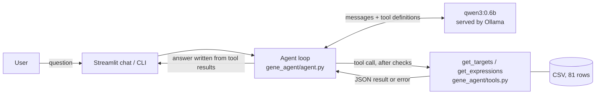

# Gene data assistant

A small agent that lets non-technical users ask questions about a cancer gene dataset in plain language. It runs entirely on your laptop: a 522 MB language model decides which of the two provided functions to call, and the answer is built from what those functions return. There is no API key and no account, and your questions never leave the machine.

## Run it

### With Docker (recommended)

```bash
docker compose up --build
```

Then open http://localhost:8501.

This starts two containers: the web app and [Ollama](https://ollama.com), which serves the model. The first start downloads the model (522 MB) into a Docker volume, and the page shows a progress bar while it does. Later starts reuse it.

The same command works on macOS (Apple Silicon or Intel) and Windows 11 with Docker Desktop. No GPU is used.

### Without Docker

You need Python 3.12 or newer and Ollama installed and running.

```bash
python -m venv .venv
source .venv/bin/activate            # Windows: .venv\Scripts\activate
pip install -r requirements.txt

streamlit run streamlit_app.py       # web app on http://localhost:8501
python cli.py                        # or a chat in the terminal
python cli.py --trace "What are the main genes involved in lung cancer?"
```

`--trace` prints each data lookup behind the answer.

To try a different model, set `OLLAMA_MODEL` (for example `OLLAMA_MODEL=lfm3`) before starting.

## What it answers

These are the four queries from the brief with the answers the app gives.

| Query | What runs | Answer |
|---|---|---|
| How can you help me? | Nothing | A short reply from the model, followed by what the assistant can do and the ten cancers it covers |
| What are the main genes involved in lung cancer? | `get_targets("lung")` | "The dataset lists 5 genes for lung cancer: ALK, RET, ROS1, STK11, KRAS." |
| What is the median value expression of genes involved in breast cancer? | `get_targets`, then `get_expressions` | A table of the 10 breast values, then "The median across these 10 genes is 0.4345 (lowest 0.032, highest 0.716)." |
| What is the median value expression of genes involved in esophageal cancer? | A lookup that fails | "'esophageal' is not in the dataset", then the list of available cancers. No numbers. |

"Median value expression of genes" could mean the value of each gene or one median across them, so the answer gives both. The dataset has no ranking of genes, so "main genes" returns every gene listed for that cancer.

It also handles follow-ups ("and their expression values?"), single genes ("what is the value of BRAF in melanoma?"), and the everyday names stomach and kidney for gastric and renal.

## How it works



| File | Role |
|---|---|
| `gene_agent/tools.py` | The two functions, their tool definitions, and `execute_tool` |
| `gene_agent/agent.py` | System prompt, the tool-calling loop, the argument checks, and the answer writer |
| `gene_agent/errors.py` | Turns model-server errors into messages a user can act on |
| `streamlit_app.py`, `cli.py` | Two thin front ends over the same `Agent` class |
| `scripts/compare_models.py` | The questions I used to choose the model |

A question goes through four steps.

1. The question and the two tool definitions go to the model. It replies with a tool call or with plain text.
2. Before a `get_expressions` call runs, the loop checks its arguments. Every gene must appear in the conversation or in an earlier tool result. If one does not, the model made it up, so the loop calls `get_targets` itself and uses the dataset's list. A missing cancer name is read from the user's question.
3. The call runs and the result goes back to the model, which can call another tool or stop.
4. If any tool returned data, the answer is written by code from those results. The model's own text is shown only when no data is involved, and it is replaced by a standard reply if it contains anything that looks like a gene symbol or a number.

Under each answer the web app has a panel listing every lookup with its input and output, including the ones the loop added.

## Choosing the model

The brief asks for something that runs on a 16 GB laptop without a specific GPU. Docker on a Mac cannot use the GPU at all, so inside the container the model runs on the CPU. That pushed me toward the smallest model that still does the job, and I set myself a limit of 1 GB.

I compared models from Ollama's library that support tool calling. Each one answered the four brief queries, sixteen paraphrases I used while tuning the loop, and eighteen questions I wrote afterwards and did not tune on. A question passes when the user is shown the right data for the right cancer and nothing else.

| Model | Download | Brief (4) | Tuned (16) | Unseen (18) | Median answer time |
|---|---|---|---|---|---|
| qwen2.5:0.5b | 397 MB | 4 | 16 | 16 | 0.6 s |
| qwen3:0.6b (chosen) | 522 MB | 4 | 16 | 18 | 0.5 s |
| granite4:350m | 708 MB | 2 | 12 | 13 | 0.5 s |
| qwen2.5:1.5b | 986 MB | 4 | 14 | 16 | 1.3 s |
| llama3.2:1b | 1.3 GB | 2 | 11 | 9 | 1.3 s |
| qwen3:1.7b | 1.4 GB | 4 | 16 | 18 | 1.1 s |
| lfm3 | 1.7 GB | 4 | 16 | 18 | 1.4 s |

Times are from an Apple M2 Pro with 16 GB, running Ollama natively. With the GPU switched off, which is the situation inside Docker, qwen3:0.6b answered the four brief queries in 1 to 2.3 seconds each. Loaded, it takes about 1 GB of memory. I have not measured an Intel Mac or a Windows laptop.

Two smaller candidates dropped out early. smollm2:360m has no tool support. functiongemma (300 MB) calls a single tool correctly but loops when it has to chain two, and took around 30 seconds on those questions.

I ran qwen3:0.6b several times. It passed all 38 questions every time except once, when it missed one unseen question.

Size did not predict quality. llama3.2:1b is more than twice the size of qwen3:0.6b and did much worse, and qwen2.5:1.5b answered some questions from memory, listing EGFR and MET for lung cancer, which are not in the dataset.

The comparison also showed what the small model cannot do. In all eleven expression questions, qwen3:0.6b went straight to `get_expressions` and never called `get_targets` first. The loop's argument check completed the chain every time. The two 1.4 to 1.7 GB models chained the calls themselves in ten of eleven. So with the default model, the model routes the question and the code does the planning. With a larger model set through `OLLAMA_MODEL`, the same loop lets the model plan and the check rarely fires.

## Design decisions and trade-offs

### Local model or hosted API

My first version called a hosted API (Claude). It was easier to build and the model was far more capable: it chained the two functions on its own and wrote good prose. But a reviewer needed their own API key before anything worked, and the questions left the machine. The brief says the prototype must run on a reviewer's laptop without me, and gives RAM and GPU limits that only make sense for a model running locally. So I switched.

What I gave up is model quality, and most of the code in `agent.py` exists to compensate for that. What I gained is that `docker compose up` is the whole setup and that no data leaves the laptop, which matters for a company working with patient data.

### A very small model, with the loop doing more

The 1.4 to 1.7 GB models needed fewer guards. I chose one about a third of their size because it is a 522 MB download, answers in one to two seconds on a CPU, and takes about 1 GB of a 16 GB machine. The price is that I had to move work from the model into code, one failure at a time:

| What small models did wrong in testing | What the code does about it |
|---|---|
| Skipped `get_targets` and passed genes from memory | Genes must come from the conversation or the dataset, otherwise the loop fetches the dataset's list |
| Left out the cancer name, or put it in the gene list | The cancer name is recovered from the question |
| Reported the lowest value as "the median" in its sentence | Answers with data are written by code |
| Answered from memory without calling a tool | Model text containing a gene symbol or a number is rejected |
| Repeated the same call | Repeated calls stop the loop |

This has a cost. Answers with data follow a fixed template, so the assistant does not write a flowing comparison of two cancers; it shows two tables. And each guard was added after seeing a failure, so there may be failures I have not seen. The unseen questions are my check on that, and they are only eighteen questions.

### Why still a tool-calling loop

With the default model the system behaves much like a router: the model identifies the request and code does the rest. A fixed pipeline (classify the question, then call the functions in a set order) would do the same with less machinery. I kept the loop for two reasons. The model still makes the decision that needs language understanding, which is whether the user wants genes, values, one gene, or nothing from the dataset. And the same code gets better when the model does: with lfm3 or qwen3:1.7b the model plans the two calls itself.

I also considered letting the model write pandas code against the CSV. It would answer any question, but the numbers would be hard to audit and it bypasses the two functions the brief asks me to orchestrate.

### No agent framework

The loop is about 40 lines on top of the Ollama Python client. LangChain or LangGraph would add tracing and persistence, and also a layer I would have to explain. With two tools I preferred code I can read top to bottom.

### Ollama as the model server

Ollama gives one official Docker image for Intel and ARM, a model download with one call, and tool calling through its chat API. The alternative was to embed llama.cpp in the app container, which removes a container but means compiling native code during the image build. The cost of Ollama is a second container and a large image.

### Smaller choices

| Choice | Why | Cost |
|---|---|---|
| Temperature 0 | The same question gives the same routing | None for this task |
| Cancer list in the system prompt, built from the CSV | The model knows what exists | Does not scale to hundreds of cancers |
| Only two everyday names (stomach, kidney) | They map to exactly one dataset cancer | "Colon" or "brain" are not mapped, because they are not exact matches |
| Unknown cancers return an error | A wrong guess would answer about a different cancer | The user has to rephrase |
| Streamlit | A chat UI in about 90 lines | Not a production front end; no login |
| Conversation kept in memory | Follow-ups work | Lost on refresh |

## Changes to the provided functions

Before writing the agent I looked at the data, and found that the script in the brief gives wrong answers to two of the four queries.

`get_expressions` looks up values by gene only. Thirteen genes appear under more than one cancer with different values (TP53 appears under eight), and the function builds a dictionary, so the last row in the file wins. For breast cancer, five of the ten values came from other cancers:

| Gene | Original returned | Correct (breast) |
|---|---|---|
| BRCA2 | 0.112 (pancreatic) | 0.032 |
| BRCA1 | 0.158 (ovarian) | 0.094 |
| TP53 | 0.373 (renal) | 0.233 |
| CDH1 | 0.834 (gastric) | 0.561 |
| PIK3CA | 0.762 (ovarian) | 0.449 |

KRAS for lung had the same problem (0.241 from pancreatic, where the lung value is 0.359). I added the cancer as a second argument: `get_expressions(genes, cancer_name)`. No prompt could have fixed this, because the function had no way to know which cancer was meant. On a team I would raise it with the function's owner before changing the signature.

The second change is to names. `get_targets("lung cancer")` and `get_targets("Lung")` returned an empty list, the same as a cancer that does not exist. Names are now normalised, and an unknown cancer raises an error that lists the available ones.

## Limits and what I would do next

- The comparison is 38 questions on one laptop. Before trusting it further I would add typos, longer conversations, and questions about two cancers at once, and run it on a Windows machine.
- Lookups work per cancer. "Which cancers involve TP53?" needs a reverse lookup that the two functions do not offer.
- The data lists HER2 under breast and ERBB2 under gastric. They are the same gene and the app does not reconcile them.
- The values have no unit or source in the CSV, so the assistant reports them as given.
- There is no login, no saved history, and no logging of questions or response times.

## Using AI-assisted coding for this exercise

I built this with an AI coding assistant (Claude Code), and I think the honest account includes where it went wrong.

It was fast at the parts that are not the point of the exercise: the Dockerfile, the Streamlit wiring, the comparison script. It also looked at the dataset before writing any agent code, which is how the `get_expressions` bug came up in the first few minutes.

It did not question the brief the way I had to. Its first design used a hosted API, which works well and is the path most examples take. Rereading the requirements, I decided the solution had to run locally on a small model, and that changed most of the design.

Its knowledge of small models was out of date. The model names it knew were a generation old, so the candidate list had to come from Ollama's current library and the choice from running them.

The generated code looked finished before it was correct. The first local version let the model write the final sentence, and for breast cancer it stated the lowest value as the median, in a fluent and confident sentence above a correct table. I only caught it by reading the actual answers. That is why answers with data are now written by code.

It also tends to add options and abstractions. I kept cutting scope back to two tools, one loop, and two thin front ends, because I have to be able to explain every line.

For real work at a company like Owkin there is one more question to settle first, which is what code and data may be sent to an assistant at all. Here the data is a small synthetic table.
