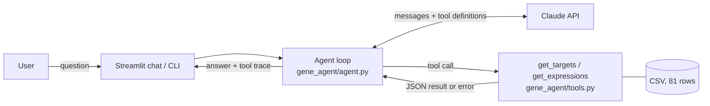

# Gene data assistant

A proof-of-concept agent that lets non-technical users query a cancer gene dataset in plain language. It orchestrates the two provided functions, `get_targets` and `get_expressions`, through an LLM tool-calling loop, and ships as a web chat (Docker) and a terminal app.

Contents: [Run it](#run-it) · [What it answers](#what-it-answers) · [Architecture](#architecture) · [Design decisions and trade-offs](#design-decisions-and-trade-offs) · [Changes to the provided functions](#changes-to-the-provided-functions) · [Limitations and next steps](#limitations-and-next-steps) · [AI-assisted coding](#using-ai-assisted-coding-for-this-exercise)

## Run it

You need an [Anthropic API key](https://console.anthropic.com/) and an internet connection. Nothing else runs locally: no GPU, no model download, well under 1 GB of RAM.

### Web app in Docker (recommended)

```bash
cp .env.example .env        # then put your key in .env
docker compose up --build
```

Open http://localhost:8501. If you skip the `.env` step, the page asks for the key in the sidebar instead.

On Windows, use `copy .env.example .env` in place of `cp`. The rest is identical.

### Without Docker

Requires Python 3.12 or newer.

```bash
python -m venv .venv
source .venv/bin/activate            # Windows: .venv\Scripts\activate
pip install -r requirements.txt
cp .env.example .env                 # then put your key in .env

streamlit run streamlit_app.py       # web app on http://localhost:8501
python cli.py                        # or: terminal chat
python cli.py --trace "What are the main genes involved in lung cancer?"
```

`--trace` prints the data lookups behind each answer.

## What it answers

Wording varies between runs; these are the facts a correct answer contains.

| Query from the brief | What happens | A correct answer contains |
|---|---|---|
| How can you help me? | No tool call | A description of the two capabilities and example questions |
| What are the main genes involved in lung cancer? | `get_targets("lung")` | ALK, RET, ROS1, STK11, KRAS |
| What is the median value expression of genes involved in breast cancer? | `get_targets` then `get_expressions` | The 10 breast values (TP53 = 0.233, BRCA1 = 0.094, ...) and the median across them, 0.4345 |
| What is the median value expression of genes involved in esophageal cancer? | `get_targets` returns an error | "Not in the dataset", the list of available cancers, and no numbers |

Because the model decides which calls to make, the same loop is designed to cover follow-ups ("and for lung?"), everyday names ("stomach cancer" for gastric), and comparisons across cancers with no extra code.

## Architecture



| File | Role |
|---|---|
| `gene_agent/tools.py` | The two functions, their tool schemas, and `execute_tool` |
| `gene_agent/agent.py` | System prompt and the tool-calling loop (about 50 lines) |
| `gene_agent/errors.py` | Maps API errors to messages a user can act on |
| `streamlit_app.py`, `cli.py` | Two thin front ends over the same `Agent` class |

One request works like this:

1. The question is appended to the conversation and sent to the model with the two tool definitions.
2. If the model asks for a tool, the agent runs it locally and returns the result. An error, such as an unknown cancer, goes back as an error result so the model can explain it.
3. This repeats until the model answers in text. The loop is capped at 8 rounds.
4. The UI shows the answer and, in an expandable panel, each lookup with its input and output.

## Design decisions and trade-offs

The guiding principle: **the model handles language, the code handles data.** The model chooses which function to call and phrases the answer. Every gene name and number comes from a function result. The audience is non-technical and will read an answer as "what our data says", so a fluent wrong number is the worst failure this product can have. Most decisions below follow from that.

### 1. A tool-calling loop, not a fixed pipeline or generated code

| Option | For | Against |
|---|---|---|
| Intent router with fixed steps (classify, then call functions in a set order) | Predictable, cheap, easy to test | Only answers what was anticipated; follow-ups and comparisons each need new branches |
| **Tool-calling loop (chosen)** | Handles unanticipated phrasing, follow-ups, and multi-cancer questions with no extra code; recovers from tool errors by itself | Non-deterministic; an expression question costs three model round trips |
| Model writes pandas code against the CSV | Most flexible: any statistic, any filter | Executes generated code; numbers are harder to trust and audit; bypasses the two functions the brief asks to orchestrate |

For exactly the four queries in the brief, the fixed pipeline would be enough. The loop is the smallest design that still earns the word "agentic": the model plans the calls, and nothing else in the system is model-driven. With two tools, a single agent is sufficient; splitting into several agents would add coordination cost and nothing else.

### 2. No agent framework

The loop is about 50 lines against the Anthropic SDK. LangChain or LangGraph would bring tracing, persistence, and provider abstraction, and also a dependency whose behaviour I would have to explain. At two tools the abstraction costs more than it saves. I would reconsider once there are many tools, long-running tasks, or a need to swap providers. Provider-specific code is confined to `agent.py`.

### 3. A hosted model, not a local one

The brief's constraints (16 GB RAM, no GPU, Mac and Windows) allow a small local model through something like Ollama. I chose a hosted model because the priority is that it runs the same on any reviewer's laptop.

| | Hosted (chosen) | Local small model |
|---|---|---|
| Setup | An API key | A multi-gigabyte download and a model server |
| Tool-calling reliability | High | Weaker on small models, which is the core of this product |
| Speed on a CPU-only laptop | Network-bound | Slow, especially on Intel |
| Data leaves the machine | Yes | No |
| Cost | Per query | None |

The data point matters most in Owkin's setting. Here, the model sees only the question and what the tools return, never the raw file, so exposure is controlled at the tool boundary. With patient-level data, that boundary is where I would enforce aggregation, and the model would need to run inside the data perimeter.

### 4. Fixing the provided function instead of working around it

`get_expressions` returned another cancer's value for genes shared across cancers ([details below](#changes-to-the-provided-functions)). No prompt can compensate for that, because the function has no way to know which cancer is meant. I added a `cancer_name` argument. The cost is a changed signature on code I was told to rely on; in a team I would raise it with the function's owner before changing it.

### 5. Unknown cancers fail loudly

Name handling is split three ways:

- **Code** normalises trivial variants ("Lung cancer" to "lung").
- **The model** maps everyday names to dataset names ("kidney" to renal) and says which one it used.
- **The tool** rejects anything else with an error listing what exists.

I avoided fuzzy matching in code: it risks silently answering about the wrong cancer. I also considered an `enum` on the tool schema, which would make an invalid call impossible. I kept the error path instead, because it makes "not in the dataset" an observable event in the tool trace, not something the model decides on its own.

### 6. Statistics computed in code

The tool returns per-gene values and a summary (count, median, min, max). The prompt tells the model to use those figures. "Median value expression of genes" can mean the per-gene values or one median across them, so the assistant reports both. The cost is that every new statistic needs code; that is the right price while trust in the numbers is the product.

### 7. The cancer list is injected into the system prompt

The prompt is built from the CSV at startup, so the model knows what exists before calling anything and the "how can you help" answer is accurate. This scales poorly: with hundreds of indications it should become a lookup tool.

### 8. Showing the work

Each answer carries its tool calls, shown in an expandable panel and by `--trace` in the CLI. A stakeholder can check which lookup produced a number without trusting the prose. The panel currently shows raw JSON, which is too technical for the target user; a friendlier rendering is a next step.

### 9. Streamlit for the UI

It gives a chat interface in about 100 lines of Python and one container. It is not a production front end: state lives in one process's session, and there is no authentication. The `Agent` class has no UI dependency, so putting it behind an API later does not touch it.

### 10. Smaller choices

| Choice | Why | Cost |
|---|---|---|
| Claude Opus 5.5 at low reasoning effort | Reliable tool use; low effort keeps a simple task fast | A smaller model would probably do at lower cost; I have not evaluated one. `ANTHROPIC_MODEL` switches it |
| Strict tool schemas | Arguments always match the schema | None |
| Server-side refusal fallback (beta) | Biomedical wording can trip safety classifiers; a declined request is retried on another model in the same call | Depends on a beta feature |
| No streaming | Simpler code | The answer appears all at once |
| Conversation kept in memory | Follow-ups work with no storage layer | Lost on refresh; history grows without trimming |
| Read-only tools, no external content | Little prompt-injection surface: only the user's own question enters the context | Changes as soon as tools write or fetch documents |

## Changes to the provided functions

Profiling the data before writing the agent showed that the script in the brief gives wrong answers to two of the four required queries.

**1. `get_expressions` returned values from the wrong cancer.** Thirteen genes appear under several cancers with a different value each time (TP53 under 8). The original filters on gene only and builds a dict, so the last matching row in the file wins. For breast cancer, 5 of 10 values were wrong:

| Gene | Original returned | Correct (breast) |
|---|---|---|
| BRCA2 | 0.112 (pancreatic) | 0.032 |
| BRCA1 | 0.158 (ovarian) | 0.094 |
| TP53 | 0.373 (renal) | 0.233 |
| CDH1 | 0.834 (gastric) | 0.561 |
| PIK3CA | 0.762 (ovarian) | 0.449 |

Lung was affected too: KRAS came back as 0.241 (pancreatic) instead of 0.359. The fix is a second argument: `get_expressions(genes, cancer_name)`.

**2. Cancer names had to match exactly.** `get_targets("lung cancer")` and `get_targets("Lung")` returned an empty list, the same as a cancer that does not exist. Names are now normalised, and an unknown cancer raises an error that lists the available ones.

The unused `import random` was dropped. Function names and return types are otherwise unchanged.

## Limitations and next steps

In rough priority order for turning this into a product:

1. **Evaluation.** There is no measured answer quality beyond the four queries. The first investment would be a question set (synonyms, typos, out-of-scope requests, comparisons) scored on every prompt or model change, which would also settle whether a cheaper model is good enough.
2. **Observability.** Tool traces, token usage, and latency are not logged. Cost and latency per question are unmeasured.
3. **Data perimeter.** For real data: a model deployment inside the perimeter, and aggregation rules enforced in the tools.
4. **Coverage of the functions.** Lookups are per cancer; "which cancers involve TP53?" needs a reverse lookup. Gene aliases are not reconciled (`HER2` under breast and `ERBB2` under gastric are the same gene). The values have no unit or provenance in the CSV, so the assistant reports them as given.
5. **Product basics.** Authentication, saved conversations, streaming, a non-technical view of the tool trace.

## Using AI-assisted coding for this exercise

This prototype was built with an AI coding assistant (Claude Code).

**Where it helped**

- Speed on the parts that are not the point: Dockerfile, Streamlit wiring, this README's structure.
- It profiled the dataset before writing any agent code, which is how the `get_expressions` bug surfaced early.
- It worked from current SDK documentation, which matters because the API changed in ways older examples get wrong.

**Where it needed care**

- I have to defend every line in front of a panel, so the code was kept small enough to read in full.
- Assistants tend to add abstraction and options. Scope was held to two tools, one loop, two thin front ends.
- Design judgment is not delegated: which trade-offs to accept above are decisions an assistant can list but not own.
- It is not a substitute for running the real thing against the real model.
- On real projects, sending proprietary code or patient-level data to an assistant is a confidentiality question to settle first. Here the data is a small synthetic table.
