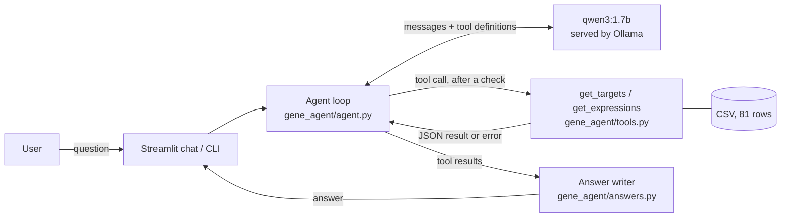

# Gene data assistant

A small agent that lets non-technical users ask questions about a cancer gene dataset in plain language. It runs entirely on a laptop. A 1.4 GB language model decides which of the two provided functions to call, and the answer is built from what those functions return. There is no API key and no account, and your questions never leave the machine.

## Quick start

You need Docker and nothing else.

```bash
git clone https://github.com/FirasHmedi/owkin-gene-agent.git
cd owkin-gene-agent
docker compose up --build
```

Open http://localhost:8501 and click one of the example questions. The first start takes a few minutes, because it builds the app and downloads the model (1.4 GB). Stop it with Ctrl+C.

[](https://github.com/FirasHmedi/owkin-gene-agent/actions/workflows/docker.yml) This check builds the same Docker setup on GitHub and asks the four queries from the brief on every change.

## How this meets the brief

| Requirement | Where it is met |
|---|---|
| Relevant answers to the four example queries | [What it answers](#what-it-answers) |
| Runs on another laptop without me | One command, no key or account: [Quick start](#quick-start) |
| README with run instructions and a design overview | [Quick start](#quick-start), [How it works](#how-it-works) |
| Web application in Docker preferred, command line acceptable | Both are included |
| Python | Python 3.12 |
| Mac or Windows 11 laptop, 16 GB RAM or less | The model takes about 1.9 GB of memory |
| No dependence on a specific GPU | Runs on CPU; the Docker run on GitHub has no GPU |
| Architecture, use and trade-offs of the AI components | [Design and trade-offs](#design-and-trade-offs) |
| Pros and cons of AI-assisted coding | [Using AI-assisted coding](#using-ai-assisted-coding) |

## Other ways to run it

`docker compose up --build` starts two containers: the web app and [Ollama](https://ollama.com), which serves the model. The model is stored in a Docker volume, so later starts are quick. The app image is also published, for Intel and ARM machines, at `ghcr.io/firashmedi/owkin-gene-agent:latest`.

Without Docker, you need Python 3.12 or newer and Ollama installed and running:

```bash
python -m venv .venv
source .venv/bin/activate            # Windows: .venv\Scripts\activate
pip install -r requirements.txt

streamlit run streamlit_app.py       # web app on http://localhost:8501
python cli.py                        # or a chat in the terminal
python cli.py --trace "What are the main genes involved in lung cancer?"
```

`--trace` prints each data lookup behind the answer.

## What it answers

| Query from the brief | What runs | Answer |
|---|---|---|
| How can you help me? | Nothing | A short reply from the model, then what the assistant can do and the ten cancers it covers |
| What are the main genes involved in lung cancer? | `get_targets` | "The dataset lists 5 genes for lung cancer: ALK, RET, ROS1, STK11, KRAS." |
| What is the median value expression of genes involved in breast cancer? | `get_targets`, then `get_expressions` | A table of the 10 breast values, then "The median across these 10 genes is 0.4345 (lowest 0.032, highest 0.716)." |
| What is the median value expression of genes involved in esophageal cancer? | A lookup that fails | "'esophageal' is not in the dataset", then the available cancers. No numbers. |

"Median value expression of genes" could mean each gene's value or one median across them, so the answer gives both. The dataset has no ranking of genes, so "main genes" returns every gene listed for that cancer.

It also answers follow-ups ("and their expression values?"), questions about one gene, and the everyday names stomach and kidney for gastric and renal.

## How it works



1. The question and the two tool definitions go to the model. It replies with a tool call or with plain text.
2. Before a `get_expressions` call runs, the loop checks its arguments. Every gene must appear in the conversation or in an earlier tool result. If one does not, the model made it up, so the loop calls `get_targets` itself and uses the dataset's list.
3. The call runs and its result goes back to the model, which can call another tool or stop.
4. If any tool returned data, the answer is written by code from those results. The model's own text is shown only when no data is involved.

Under each answer, the web app lists every lookup with its input and output.

| File | Role |
|---|---|
| `gene_agent/tools.py` | The two functions, their tool definitions, and `execute_tool` |
| `gene_agent/agent.py` | System prompt, the tool-calling loop, and the argument check |
| `gene_agent/answers.py` | Writes the answer from tool results |
| `gene_agent/errors.py` | Turns model-server errors into messages a user can act on |
| `streamlit_app.py`, `cli.py` | Two thin front ends over the same `Agent` class |

## Design and trade-offs

### From most predictable to most flexible

The main design question is how much to leave to the model. There are four places to stand:

| Design | Who decides the steps | Who states the facts | What you get | What you give up |
|---|---|---|---|---|
| Fixed pipeline | Code | Code | The same answer every time, easy to check | Only the questions I planned for |
| Tool-calling loop with checks (this project) | Model, checked by code | Code | Free phrasing, follow-ups, new kinds of question about the same data | Answers follow a template |
| Tool-calling loop, model writes the answer | Model | Model | Natural, flowing answers | A fluent sentence can carry a wrong number |
| Model writes its own analysis code | Model | Model's code | Any question about the data | Numbers are hard to audit; the two provided functions are bypassed |

I chose the second. The users are non-technical and will read an answer as "what our data says", so the worst failure is a confident wrong number. The model keeps the part that needs language understanding: working out whether the user wants genes, values, one gene, or nothing from the dataset, and choosing the calls. Code keeps the facts.

I started one step to the right, with the model writing the answer. In testing, a small model stated the lowest value as "the median", in a fluent sentence above a correct table. That moved the answer writing into code.

The cost is real. The assistant does not write a flowing comparison of two cancers; it shows two tables. I would move right again with a larger model and a question set big enough to measure how often its sentences are wrong. I would move left, to a fixed pipeline, if only the four queries mattered.

### The model

The default is qwen3:1.7b, a 1.4 GB download that takes about 1.9 GB of memory and needs no GPU, which fits the brief's 16 GB limit with room to spare. It supports tool calling through Ollama. On the 38 questions I tested, it answered all of them correctly, and it made both calls itself in 15 of the 16 answers that needed two, so the model does the orchestration and the checks stay a safety net. A smaller model can be used by setting `OLLAMA_MODEL`.

### What the code checks

Each row is a failure I saw from a small model, and what the code now does about it.

| What went wrong | What the code does |
|---|---|
| Skipped `get_targets` and passed genes from memory | Genes must come from the conversation or the dataset; otherwise the loop fetches the dataset's list |
| Stopped after `get_targets` although values were asked | The loop asks it once to check the question again |
| Stated the lowest value as "the median" | Answers with data are written by code |
| Answered from memory without calling a tool | Model text containing a gene symbol or a number is dropped |

Each check was added after seeing a failure, so there may be failures I have not seen.

### Smaller choices

| Choice | Why | Cost |
|---|---|---|
| No agent framework | The loop is about 50 lines I can read from top to bottom | No built-in tracing or persistence |
| Ollama as model server | One official image for Intel and ARM, with tool calling | A second container |
| Only the last exchange kept as context | Follow-ups work and a small model does not drift | Earlier turns are forgotten |
| Unknown cancers return an error | A wrong guess would answer about a different cancer | The user has to rephrase |
| Streamlit | A chat UI in about 100 lines | Not a production front end |

## Changes to the provided functions

The script in the brief gives wrong answers to two of the four queries. `get_expressions` looks up values by gene only, and thirteen genes appear under more than one cancer with different values (TP53 appears under eight). The last row in the file wins, so for breast cancer five of the ten values came from other cancers. TP53, for example, returned 0.373 (the renal value) where breast is 0.233.

I added the cancer as a second argument: `get_expressions(genes, cancer_name)`. No prompt could have fixed this, because the function had no way to know which cancer was meant.

`get_targets("lung cancer")` and `get_targets("Lung")` also returned an empty list, the same as a cancer that does not exist. Names are now normalised, and an unknown cancer raises an error listing the available ones.

## What I tested and what I did not

Tested:

- Docker: a GitHub Actions workflow builds the setup on every push, starts both containers on a Linux machine with no GPU, downloads the model, and asks the four brief queries. It checks the lung genes, the breast median, and that the esophageal answer contains no numbers.
- 38 questions in `scripts/compare_models.py` (the four from the brief and paraphrases of them), on an Apple M2 Pro with 16 GB. All passed in five runs.
- The four brief queries asked in one conversation, in all 24 orders. All 96 answers were correct.

Not tested:

- Docker Desktop on a Mac or on Windows 11.
- Questions about two cancers at once, long conversations, and heavy typos.

Known limits: lookups work per cancer, so "which cancers involve TP53?" is not supported. The data lists HER2 under breast and ERBB2 under gastric, which are the same gene, and the app does not reconcile them.

## Using AI-assisted coding

I built this with an AI coding assistant (Claude Code).

Where it helped:

- It was fast at the parts that are not the point of the exercise: the Dockerfile, the Streamlit wiring, the test questions.
- It looked at the dataset before writing any agent code, which is how the `get_expressions` bug came up in the first few minutes.

Where it fell short:

- It did not question the brief. Its first design used a hosted API. Rereading the requirements, I decided the solution had to run locally on a small model, and that changed most of the design.
- Its knowledge of small models was out of date, so the model had to be chosen by running candidates from Ollama's current library.
- The generated code looked finished before it was correct. The wrong "median" sentence only showed up by reading actual answers.
- Its test questions each started a fresh conversation. Asking the four brief queries in one chat, the way a reviewer would, gave a wrong answer to the third. I found that by using the web app.
- It tends to add options and abstractions. I kept cutting scope back, because I have to be able to explain every line.

For real work at a company like Owkin there is one more question to settle first: what code and data may be sent to an assistant at all. Here the data is a small synthetic table.
