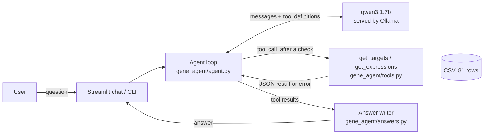

# Gene data assistant

A small agent that lets non-technical users ask questions about a cancer gene dataset in plain language. It runs entirely on a laptop. A 1.4 GB language model decides which of the two provided functions to call, and the answer is built from what those functions return. There is no API key and no account, and your questions never leave the machine.

## How this meets the brief

| Requirement | Where it is met |
|---|---|
| Relevant answers to the four example queries | [What it answers](#what-it-answers) |
| Runs on another laptop without me | One command, no key or account: [Run it](#run-it) |
| README with run instructions and a design overview | [Run it](#run-it), [How it works](#how-it-works) |
| Web application in Docker preferred, command line acceptable | Both are included |
| Python | Python 3.12 |
| Mac (Apple Silicon or Intel) and Windows 11, 16 GB RAM or less | The model takes about 1.9 GB of memory. See [what I tested](#what-i-tested-and-what-i-did-not) for which machines I measured |
| No dependence on a specific GPU | Runs on CPU. I measured it with the GPU switched off |
| Architecture, use and trade-offs of the AI components | [AI components and their trade-offs](#ai-components-and-their-trade-offs) |
| Pros and cons of AI-assisted coding | [Using AI-assisted coding](#using-ai-assisted-coding-for-this-exercise) |

## Run it

### With Docker

```bash
docker compose up --build
```

Then open http://localhost:8501.

This starts two containers: the web app, and [Ollama](https://ollama.com), which serves the model. On the first start the app downloads the model (1.4 GB) into a Docker volume and shows a progress bar. Later starts reuse it.

### Without Docker

You need Python 3.12 or newer, and Ollama installed and running.

```bash
python -m venv .venv
source .venv/bin/activate            # Windows: .venv\Scripts\activate
pip install -r requirements.txt

streamlit run streamlit_app.py       # web app on http://localhost:8501
python cli.py                        # or a chat in the terminal
python cli.py --trace "What are the main genes involved in lung cancer?"
```

`--trace` prints each data lookup behind the answer.

### Using another model

Set `OLLAMA_MODEL` before starting, for example `OLLAMA_MODEL=qwen3:0.6b` for a 522 MB model that also passes every question I tested.

## What it answers

The four queries from the brief, with the answers the app gives.

| Query | What runs | Answer |
|---|---|---|
| How can you help me? | Nothing | A short reply from the model, followed by what the assistant can do and the ten cancers it covers |
| What are the main genes involved in lung cancer? | `get_targets` | "The dataset lists 5 genes for lung cancer: ALK, RET, ROS1, STK11, KRAS." |
| What is the median value expression of genes involved in breast cancer? | `get_targets`, then `get_expressions` | A table of the 10 breast values, then "The median across these 10 genes is 0.4345 (lowest 0.032, highest 0.716)." |
| What is the median value expression of genes involved in esophageal cancer? | A lookup that fails | "'esophageal' is not in the dataset", then the list of available cancers. No numbers. |

Two wording choices are worth knowing. "Median value expression of genes" could mean the value of each gene or one median across them, so the answer gives both. The dataset has no ranking of genes, so "main genes" returns every gene listed for that cancer.

It also answers follow-ups ("and their expression values?"), questions about one gene ("what is the value of BRAF in melanoma?"), and the everyday names stomach and kidney for gastric and renal.

## How it works



| File | Role |
|---|---|
| `gene_agent/tools.py` | The two functions, their tool definitions, and `execute_tool` |
| `gene_agent/agent.py` | System prompt, the tool-calling loop, and the argument check |
| `gene_agent/answers.py` | Writes the answer from tool results |
| `gene_agent/errors.py` | Turns model-server errors into messages a user can act on |
| `streamlit_app.py`, `cli.py` | Two thin front ends over the same `Agent` class |
| `scripts/compare_models.py` | The 38 questions I used to choose the model |

A question goes through four steps.

1. The question and the two tool definitions go to the model. It replies with a tool call or with plain text.
2. Before a `get_expressions` call runs, the loop checks its arguments. Every gene must appear in the conversation or in an earlier tool result. If one does not, the model made it up, so the loop calls `get_targets` itself and uses the dataset's list.
3. The call runs and its result goes back to the model, which can call another tool or stop.
4. If any tool returned data, the answer is written by code from those results. The model's own text is shown only when no data is involved, and it is replaced by a standard reply if it contains anything that looks like a gene symbol or a number.

Under each answer, the web app has a panel listing every lookup with its input and output, including any the loop added itself.

## AI components and their trade-offs

There is one AI component: a small language model that reads the question and chooses tool calls. Everything else is ordinary code. The decisions below are about how much to ask of that model.

### A local model, not a hosted API

My first version called a hosted API (Claude). It was easier to build and the model was far more capable. But a reviewer needed their own API key before anything worked, and every question left the machine. The brief says the prototype must run on a reviewer's laptop without me, and its RAM and GPU limits only make sense for a model running locally. So I switched.

| | Local (chosen) | Hosted API |
|---|---|---|
| Setup for a reviewer | One command | An account and an API key |
| Data | Stays on the laptop | Sent to a provider |
| Model capability | Limited; needs the checks described below | High |
| Cost per question | None | Paid |
| First start | Downloads 1.4 GB | Immediate |

For a company working with patient data, the second row would decide it even without the brief.

### Which model

I set a limit of 1.5 GB for the download and compared tool-calling models from Ollama's library. Each one answered the four brief queries, sixteen paraphrases I used while tuning the loop, and eighteen questions I wrote afterwards and did not tune on. A question passes when the user is shown the right data for the right cancer and nothing else.

| Model | Download | Brief (4) | Tuned (16) | Unseen (18) | Median answer time |
|---|---|---|---|---|---|
| qwen2.5:0.5b | 397 MB | 4 | 16 | 16 | 0.6 s |
| qwen3:0.6b | 522 MB | 4 | 16 | 18 | 0.5 s |
| granite4:350m | 708 MB | 2 | 12 | 13 | 0.5 s |
| qwen2.5:1.5b | 986 MB | 4 | 14 | 16 | 1.3 s |
| llama3.2:1b | 1.3 GB | 2 | 11 | 9 | 1.3 s |
| qwen3:1.7b (chosen) | 1.4 GB | 4 | 16 | 18 | 1.1 s |
| lfm3 | 1.7 GB | 4 | 16 | 18 | 1.4 s |

Two smaller candidates dropped out before this table. smollm2:360m has no tool support. functiongemma (300 MB) calls one tool correctly but loops when it has to chain two.

Two models under the limit passed everything: qwen3:0.6b and qwen3:1.7b. What separates them is who does the planning. An expression question needs two calls, `get_targets` and then `get_expressions`. qwen3:1.7b made both calls itself in 15 of the 16 answers that needed them (13 in a run with the GPU off). qwen3:0.6b almost never did (0 or 1 of 11, depending on the run). It went straight to `get_expressions` with genes from memory, and the loop's check completed the chain for it.

I chose qwen3:1.7b because I want the model to do the orchestration the brief asks for, with the check as a safety net. It costs 900 MB more to download and answers more slowly. The smaller model stays available through `OLLAMA_MODEL`.

Size did not predict quality. llama3.2:1b is more than twice the size of qwen3:0.6b and did much worse. qwen2.5:1.5b answered some questions from memory, listing EGFR and MET for lung cancer, which are not in the dataset.

### What the code does so the model does not have to

Each row is a failure I saw from a small model during testing, and what the code now does about it.

| What went wrong | What the code does |
|---|---|
| Skipped `get_targets` and passed genes from memory | Genes must come from the conversation or the dataset; otherwise the loop fetches the dataset's list |
| Left out the cancer name, or put it in the gene list | The cancer name is recovered from the question |
| Stated the lowest value as "the median" in a fluent sentence | Answers with data are written by code |
| Answered from memory without calling a tool | Model text containing a gene symbol or a number is dropped |
| Stopped after `get_targets` although values were asked | The loop asks it once to check the question again |
| Repeated the same call | A repeated call stops the loop |

With qwen3:1.7b most of these rarely fire. I kept them all for two reasons. They make the facts on screen independent of the model's wording, which is what a non-technical user needs to be able to trust. And I did not measure how accurate the larger model's own sentences are, so I have no evidence for letting it write them.

The cost is that answers with data follow a fixed template. The assistant does not write a flowing comparison of two cancers; it shows two tables. Each check was also added after seeing a failure, so there may be failures I have not seen. The unseen questions are my test of that, and there are only eighteen of them.

### A tool-calling loop, and no framework

I considered two other designs. A fixed pipeline (classify the question, then call the functions in a set order) is more predictable, but each new kind of question needs a new branch. Letting the model write pandas code against the CSV would answer anything, but the numbers would be hard to audit and it bypasses the two functions the brief asks me to orchestrate. The loop sits between them: the model decides the calls, and the calls are the only source of facts.

The loop is about 40 lines on top of the Ollama Python client. LangChain or LangGraph would add tracing and persistence, and also a layer I would have to explain. With two tools I preferred code I can read from top to bottom.

### Ollama as the model server

Ollama gives one official Docker image for Intel and ARM, downloads a model with one call, and supports tool calling through its chat API. The alternative was to embed llama.cpp in the app container, which removes a container but means compiling native code during the image build. The cost of Ollama is a second container and a large image.

### Smaller choices

| Choice | Why | Cost |
|---|---|---|
| Temperature 0 | The same question gives the same routing | None for this task |
| Cancer list in the system prompt, built from the CSV | The model knows what exists | Does not scale to hundreds of cancers |
| Only two everyday names (stomach, kidney) | Each maps to exactly one dataset cancer | "Colon" or "brain" are not mapped, because they are not exact matches |
| Unknown cancers return an error | A wrong guess would answer about a different cancer | The user has to rephrase |
| Streamlit | A chat UI in about 100 lines | Not a production front end; no login |
| Only the last exchange is kept as context | Follow-ups work, and a small model does not drift as the chat grows | Earlier turns are forgotten |

## Changes to the provided functions

Before writing the agent I looked at the data, and found that the script in the brief gives wrong answers to two of the four queries.

`get_expressions` looks up values by gene only. Thirteen genes appear under more than one cancer with different values (TP53 appears under eight), and the function builds a dictionary, so the last row in the file wins. For breast cancer, five of the ten values came from other cancers:

| Gene | Original returned | Correct (breast) |
|---|---|---|
| BRCA2 | 0.112 (pancreatic) | 0.032 |
| BRCA1 | 0.158 (ovarian) | 0.094 |
| TP53 | 0.373 (renal) | 0.233 |
| CDH1 | 0.834 (gastric) | 0.561 |
| PIK3CA | 0.762 (ovarian) | 0.449 |

KRAS for lung had the same problem: it returned 0.241 from pancreatic, where the lung value is 0.359. I added the cancer as a second argument, `get_expressions(genes, cancer_name)`. No prompt could have fixed this, because the function had no way to know which cancer was meant. On a team I would raise it with the function's owner before changing the signature.

The second change is to names. `get_targets("lung cancer")` and `get_targets("Lung")` returned an empty list, the same as a cancer that does not exist. Names are now normalised, and an unknown cancer raises an error that lists the available ones.

## What I tested and what I did not

Tested, on an Apple M2 Pro with 16 GB running macOS 14 and Ollama installed natively:

- The 38 questions in `scripts/compare_models.py`. qwen3:1.7b passed all of them in five runs.
- The four brief queries asked one after another in a single conversation, in all 24 possible orders. All 96 answers were correct.
- The web app and the terminal app, by hand, on the four brief queries.
- The same four queries with the GPU switched off, to approximate a machine without one. They took between 0.5 and 9 seconds each; the two-step breast query was the slowest. Loaded, the model takes about 1.9 GB of memory.

Not tested:

- The Docker Compose setup. It uses the official Ollama image and the same code, but I have not run it.
- An Intel Mac or a Windows 11 laptop.
- Questions about two cancers at once, long conversations, and heavy typos.

## Limits and next steps

- Lookups work per cancer. "Which cancers involve TP53?" needs a reverse lookup that the two functions do not offer.
- The data lists HER2 under breast and ERBB2 under gastric. They are the same gene and the app does not reconcile them.
- The values have no unit or source in the CSV, so the assistant reports them as given.
- There is no login, no saved history, and no logging of questions or response times.
- The next thing I would build is a larger question set, run on every change to the prompt, the checks, or the model.

## Using AI-assisted coding for this exercise

I built this with an AI coding assistant (Claude Code).

Where it helped:

- It was fast at the parts that are not the point of the exercise: the Dockerfile, the Streamlit wiring, the comparison script.
- It looked at the dataset before writing any agent code, which is how the `get_expressions` bug came up in the first few minutes.
- It ran the model comparison across seven models, which would have taken me much longer by hand.

Where it fell short:

- It did not question the brief. Its first design used a hosted API, which works well and is what most examples do. Rereading the requirements, I decided the solution had to run locally on a small model, and that changed most of the design.
- Its knowledge of small models was out of date. The model names it knew were a generation old, so the candidate list had to come from Ollama's current library and the choice from running them.
- The generated code looked finished before it was correct. The first local version let the model write the final sentence, and one model stated the lowest value as the median, in a confident sentence above a correct table. That only showed up by reading the actual answers.
- Its test questions each started a fresh conversation. Asking the four brief queries in one chat, the way a reviewer would, gave a wrong answer to the third. I found that by using the web app, and it led to two of the checks above.
- It tends to add options and abstractions. I kept cutting scope back to two tools, one loop, and two thin front ends, because I have to be able to explain every line.

For real work at a company like Owkin there is one more question to settle first, which is what code and data may be sent to an assistant at all. Here the data is a small synthetic table.
